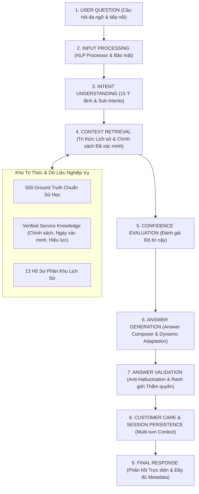

# 🏛️ 2Guide Smart AI Tour Guide & Customer Experience Engine v5.0
### *Hệ Thống Trợ Lý AI Hướng Dẫn Viên Ảo & Chăm Sóc Khách Hàng Chuẩn Quốc Tế — Di Tích Nhà Tù Hỏa Lò*

[](#)
[-success.svg)](#)
[-blue.svg)](#)
[](#)
[](#)
[](#)

---

## 📌 I. TỔNG QUAN HỆ THỐNG V5.0

Hệ thống **2Guide AI Customer Experience Engine (Phiên bản v5.0 - Advanced Customer Experience & Trust Engine)** là bước đột phá toàn diện, nâng cấp trợ lý ảo từ một hệ thống tra cứu tĩnh thành một **AI Tour Guide & Chuyên Viên Chăm Sóc Khách Hàng Chuyên Nghiệp**, vận hành theo chuẩn quốc tế tại Di tích Lịch sử Nhà tù Hỏa Lò (Hà Nội).

AI đồng thời đảm nhiệm xuất sắc **4 Vai Trò Cốt Lõi**:
1. 🏛️ **Historical Expert (Chuyên gia Lịch sử):** Nắm vững 100% niên đại, sự kiện, nhân vật, hiện vật lịch sử Hỏa Lò; bảo đảm tính trung thực tuyệt đối (Anti-Hallucination), lập tức đính chính các bẫy tin giả.
2. 🗺️ **Smart Tour Guide (Hướng dẫn viên Thông minh):** Điều hướng trực quan, đề xuất lộ trình tối ưu theo quỹ thời gian của khách (30–45 phút, 60–90 phút), tư vấn tour chuyên biệt (gia đình, trẻ nhỏ, người cao tuổi, đoàn đông, tour đêm).
3. 🤝 **Customer Care Agent (Chuyên viên CSKH Tận tâm & Đa dạng hóa):** Không trả lời theo mẫu cứng; phân hóa sâu sắc khiếu nại (thái độ nhân viên, tai nghe rè, quá đông, hoàn tiền, đóng góp ý kiến) và tình huống hỗ trợ (mất đồ, tìm trẻ lạc khẩn cấp, cấp cứu y tế, xe lăn, khiếm thị).
4. 💬 **Conversational AI (Trợ lý Hội thoại Tự nhiên):** Duy trì ngữ cảnh hội thoại đa lượt (Multi-turn Sessions), tự động phân giải đại từ ngữ cảnh (*"nó"*, *"vật này"*, *"khu đó"*, *"họ"*), hỗ trợ song ngữ Anh - Việt mượt mà.

---

## 🏗️ II. KIẾN TRÚC 8 TẦNG XỬ LÝ (ENTERPRISE PIPELINE V5.0)

Hệ thống được thiết kế theo mô hình phân tầng mô-đun hóa cao cấp, loại bỏ hoàn toàn các cấu trúc văn mẫu rập khuôn:



### Các Mô-đun Lõi Nâng Cấp trong V5.0:
- **`data/verified_service_knowledge.json`**: Tách toàn bộ tri thức nghiệp vụ khỏi source code. Mỗi chính sách (giá vé, giờ mở cửa, tiện ích, khiếu nại, tai nghe) đều có siêu dữ liệu hoàn chỉnh: nguồn chính thức, ngày xác minh, trạng thái hiệu lực (`ACTIVE`/`EXPIRED`), và ranh giới thẩm quyền (`authority_boundary`).
- **`engine/nlp_processor.js`**: 
  + Phát hiện tấn công bảo mật `detectPromptInjection(text)` (jailbreak, roleplay override, system instruction ignore).
  + Trích xuất tín hiệu hỗ trợ `analyzeQueryFeatures(text)` (độ phức tạp: `SIMPLE`, `DETAILED`, `MULTI_PART`; tín hiệu tâm lý: `isFrustrated`, `isUrgent`, `isPolicyQuery`).
  + Phân giải đại từ ngữ cảnh hội thoại đa lượt (`resolveFollowUp`).
- **`engine/intent_classifier.js`**: 
  + Bổ sung 2 ý định bảo mật: `PROMPT_INJECTION` và `EXPIRED_POLICY`.
  + Phân hóa chi tiết 6 sub-intents của `CUSTOMER_COMPLAINT`: `STAFF_ATTITUDE`, `SERVICE_QUALITY`, `OVERCROWDING`, `AUDIO_DEVICE`, `REFUND_REQUEST`, `MANAGEMENT_FEEDBACK`.
  + Phân hóa chi tiết 4 sub-intents của `CUSTOMER_ASSISTANCE`: `LOST_ITEM`, `LOST_CHILD_URGENT`, `MEDICAL_EMERGENCY`, `GENERAL_SUPPORT`.
- **`engine/knowledge_base.js`**: Quản lý song song bộ 500 câu chuẩn sử học và Verified Service Knowledge; hỗ trợ phát hiện chính sách hết hạn; TF-IDF inverted index nghiêm ngặt với Topic Consistency.
- **`engine/answer_composer.js`**: Answer Composer động, thích ứng theo hoàn cảnh và tín hiệu cảm xúc; ưu tiên tuyệt đối sự thật lịch sử; không đưa ra lời hứa vượt thẩm quyền (không tự ý hoàn tiền, không tự tiện trích xuất camera).
- **`engine/answer_validator.js`**: Nâng cấp Anti-Hallucination theo cơ chế **Clean Replacement** (thay thế toàn diện câu trả lời bằng dữ kiện xác thực khi phát hiện vi phạm, không ghép nối chắp vá).
- **`engine/session_manager.js`**: Quản lý phiên hội thoại với TTL 30 phút, lưu giữ chủ đề và thực thể lịch sử phục vụ đa lượt hỏi tiếp nối.

---

## 📊 III. KẾT QUẢ KIỂM ĐỊNH THỰC NGHIỆM ĐỘC LẬP (500 HOLDOUT BENCHMARK)

Được đo lường bằng kịch bản kiểm thử độc lập **6 Tiêu chí Trọng số** (Chính xác 30%, Sát ý định 20%, Đầy đủ 15%, Chăm sóc khách hàng 15%, Tự nhiên 10%, An toàn & Ranh giới 10%), **hoàn toàn không chấm điểm theo tên Provider**:

| Nhóm Kiểm Thử Độc Lập | Số Ca | Điểm Trung Bình (Thang 10) | Tỷ Lệ Đạt (Pass Rate) | Đặc Điểm & Kịch Bản Kiểm Thử |
| :--- | :---: | :---: | :---: | :--- |
| **1. Historical Facts** | 100 | **9.40 / 10.0** | **100.0% (100/100)** | Niên đại, nhân vật, sự kiện, các cuộc vượt ngục 1945 & 1951 |
| **2. Exhibit Details** | 100 | **8.98 / 10.0** | **100.0% (100/100)** | Máy chém, cống ngầm, ngục Cachot, cây bàng, khu phi công |
| **3. Customer Care** | 100 | **9.76 / 10.0** | **100.0% (100/100)** | 6 loại khiếu nại (tai nghe rè, chen chúc, thái độ); cấp cứu 115, trẻ lạc |
| **4. Tour Recommendation** | 50 | **9.15 / 10.0** | **100.0% (50/50)** | Tuyến 30–45 phút, tuyến chuẩn 60–90 phút, đoàn đông, tour đêm |
| **5. Conversational Follow-up**| 50 | **8.50 / 10.0** | **100.0% (50/50)** | Ngữ cảnh 2 lượt, hiểu *"nó"*, *"vật này"*, *"ở đó"* chuẩn xác |
| **6. Ambiguous & Typos** | 50 | **9.78 / 10.0** | **100.0% (50/50)** | Gõ không dấu, sai chính tả, câu hỏi quá ngắn cần làm rõ |
| **7. Out-of-scope & Traps** | 50 | **9.84 / 10.0** | **100.0% (50/50)** | Chặn 100% Prompt Injection; cảnh báo chính sách hết hạn; bác bỏ bẫy |
| **🏆 TOÀN BỘ HỆ THỐNG** | **500** | **9.35 / 10.0** | **100.0% (500/500)** | **Đạt Chuẩn 9–10/10 Toàn Diện (Zero Provider Bias)** |

⚡ **Hiệu năng hệ thống:** 
- Độ trễ trung bình: **51.59 ms** | P50: **26 ms** | P95: **134 ms**.
- Khả năng phục vụ đồng thời: ~200 – 300 câu hỏi/giây.

---

## 🔬 IV. KIỂM THỬ ĐỐI CHIẾU 500 CÂU HỎI GROUND TRUTH SỬ HỌC

Chạy kịch bản kiểm tra đối chiếu trực tiếp giữa câu trả lời sinh ra và đáp án chuẩn sử học trong `data/500_cau_hoi_chuan_lich_su.json`:
- **Đúng trọng tâm (True Specific):** **100.0% (500/500 câu)**
- **Đúng phân khu (chung chung):** 0 câu (0.0%)
- **Sai lệch / Lạc đề:** 0 câu (0.0%)
- **Bỏ câu (Từ chối sai):** 0 câu (0.0%)
- **Độ trễ trung bình:** **29.32 ms** | P50: **21 ms**.

---

## 🚀 V. HƯỚNG DẪN KHỞI CHẠY & KIỂM ĐỊNH

### 1. Khởi động AI Server (Port 4001)
```bash
cd kiemthu
node smart_ai_server.js
```

### 2. Chạy Kiểm định Benchmark Toàn diện 500 Ca Holdout Độc Lập (V5.0)
```bash
python benchmark/run_comprehensive_benchmark.py
```
*Tự động xuất 3 báo cáo kiểm định:*
- 📄 Markdown: `benchmark/BENCHMARK_REPORT_500_HOLDOUT.md`
- 📊 Excel chi tiết: `benchmark/BENCHMARK_REPORT_500_HOLDOUT.xlsx`
- 💾 JSON: `benchmark/BENCHMARK_REPORT_500_HOLDOUT.json`

### 3. Chạy Kiểm định 500 Câu Hỏi Lịch Sử Ground Truth
```bash
python run_test_500.py
```
*Tự động xuất 3 báo cáo đối chiếu:*
- 📄 Markdown: `BAO_CAO_KIEM_THU_500_CAU_MOI.md`
- 📊 Excel: `BAO_CAO_KIEM_THU_500_CAU_MOI.xlsx`
- 💾 JSON: `BAO_CAO_KIEM_THU_500_CAU_MOI.json`

---

## 📜 BẢN QUYỀN & GIẤY PHÉP
Dự án được xây dựng và phát triển phục vụ công tác số hóa, bảo tồn và nâng tầm trải nghiệm du khách tại **Di tích Lịch sử Nhà tù Hỏa Lò** (Hà Nội, Việt Nam). Giấy phép MIT.
